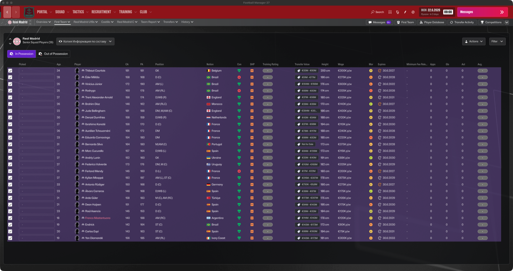
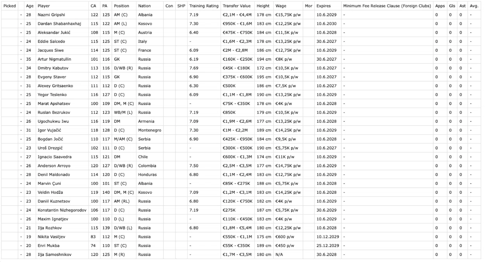

# FM27 Player Export (macOS / Windows)

[](../../releases/latest)
[](LICENSE)

Export any visible table in **Football Manager 27** (squad, player search,
shortlists, league tables…) to **CSV** and **HTML** with a single key press —
no database editor required.

> **Why it exists:** to take squad lists and transfer-market shortlists out of
> the game and analyse them with AI — see [DESCRIPTION.md](DESCRIPTION.md).

## Download

* **Ready-to-use build:** grab `FM27PlayerExport-v1.0.zip` from the
  [latest release](../../releases/latest). It contains the plugin DLL, this
  README, credits and screenshots.
* **Build it yourself:** see [BUILDING.md](BUILDING.md). Sources are in `src/`.

## Screenshots

| In game | Exported file |
|---|---|
|  |  |

## What it does

* Reads the table currently displayed in the game window.
* Exports every row to a semicolon-separated **CSV** (UTF-8) and a styled
  **HTML** copy you can open in any browser.
* Works on the squad screen, player search results, shortlists, staff lists,
  and league tables.
* Runs entirely locally — no network access, no telemetry.

## Hotkeys

| Key | Action |
|---|---|
| **F9** | Export the current table |
| **F10** | Diagnostic: dump the game's UI tree to the log (only needed for bug reports) |

Press the key while a table with rows is open and focused. Do not move the
mouse while the export runs.

## Where the files go

```
<saved games folder>/Sports Interactive/Football Manager 27/FM27PlayerExport by vinteset/
    Exports CSV/fm27_table_YYYYMMDD_HHMMSS.csv
    Exports HTML/fm27_table_YYYYMMDD_HHMMSS.html
```

On macOS that is `~/Sports Interactive/…`; on Windows it is
`Documents\Sports Interactive\…`.

---

## Requirements

| | macOS | Windows |
|---|---|---|
| Game | Football Manager 27 (Steam) | Football Manager 27 (Steam) |
| Framework | [FM27-BepInEx for Apple Silicon](https://sortitoutsi.net/content/78080/) (community package by **codexx01**) | [BepInEx 6 IL2CPP](https://builds.bepinex.dev/projects/bepinex_be) (bleeding-edge, x64) |
| This package | `FM26PlayerExport.dll` | `FM26PlayerExport.dll` |

> The plugin DLL is built from portable C# and uses only the game's managed
> interop assemblies, so the same file is used on both platforms.
>
> It was compiled against **Il2CppInterop 1.5.x**. If the plugin does not
> appear in the log on Windows, use a BepInEx 6 build that ships a matching
> Il2CppInterop version, or rebuild the plugin from source against your
> platform's interop assemblies.

---

## Installation

### macOS

1. Install the **FM27-BepInEx** package (Apple Silicon, macOS 27+) following
   its own instructions: unzip it into your FM27 game folder next to `fm.app`
   and start the game once through its launcher so BepInEx generates its
   files. You should see `Chainloader startup complete` in
   `FM27-BepInEx/BepInEx/LogOutput.log`.
2. Copy `FM26PlayerExport.dll` into:

   ```
   ~/Library/Application Support/Steam/steamapps/common/Football Manager 27/FM27-BepInEx/BepInEx/plugins/
   ```

3. Start the game through the package's launcher (`run_fm27_bepinex.sh`).
4. Open a table and press **F9**.

### Windows

1. Install **BepInEx 6 IL2CPP** (bleeding-edge build) into your FM27 folder
   and run the game once so BepInEx initialises.
2. Copy `FM26PlayerExport.dll` into:

   ```
   <Steam>\steamapps\common\Football Manager 27\BepInEx\plugins\
   ```

3. Start the game normally from Steam.
4. Open a table and press **F9**.

---

## Configuration

After the first launch, edit
`BepInEx/config/com.koda.fm26.playerexport.cfg`:

```ini
[Export]
## Frames to wait after each scroll step before reading rows.
## Higher = slower but more stable on very long lists (60 fps ⇒ 30 ≈ 0.5 s).
ScrollStepDelayFrames = 30

## Maximum number of rows captured per export.
MaxRowsToExport = 10000
```

If an export of a very long list (10 000+ rows) ends early or is unstable,
raise `ScrollStepDelayFrames` to 40–60.

---

## Troubleshooting

| Symptom | What to do |
|---|---|
| Nothing happens on F9 | Make sure a table is open and focused, and that the plugin loaded: look for `Loading [FM26 Player Export` in `BepInEx/LogOutput.log`. |
| `[FM27] заголовков мало` / no columns | The screen is not a supported table — open a squad/player list first. |
| CSV is empty | No rows are visible; scroll the list so at least one row is on screen. |
| Game does not start | Remove `FM26PlayerExport.dll` from `plugins/` and start again — the base BepInEx setup is then proven, and the plugin is the only variable. |
| Very slow export | Lower `MaxRowsToExport` or raise `ScrollStepDelayFrames`. |

Bug reports are much easier with the log file from
`BepInEx/LogOutput.log` plus the F10 UI dump.

---

## Uninstall

Delete `FM26PlayerExport.dll` from the `plugins/` folder. Nothing else is
modified; exported files stay where they are.

---

## Notes

* The plugin only **reads** the game's UI. It does not modify saves, the
  database, or any game files.
* CA/PA and other "hidden" columns appear only when the in-game editor is
  active on your account; the export always mirrors the visible columns.
* Football Manager is a trademark of Sports Interactive / SEGA. This project
  is unofficial and not affiliated with or endorsed by Sports Interactive or
  SEGA.

See `CREDITS.md` for authors and `LICENSE` for licensing terms.
